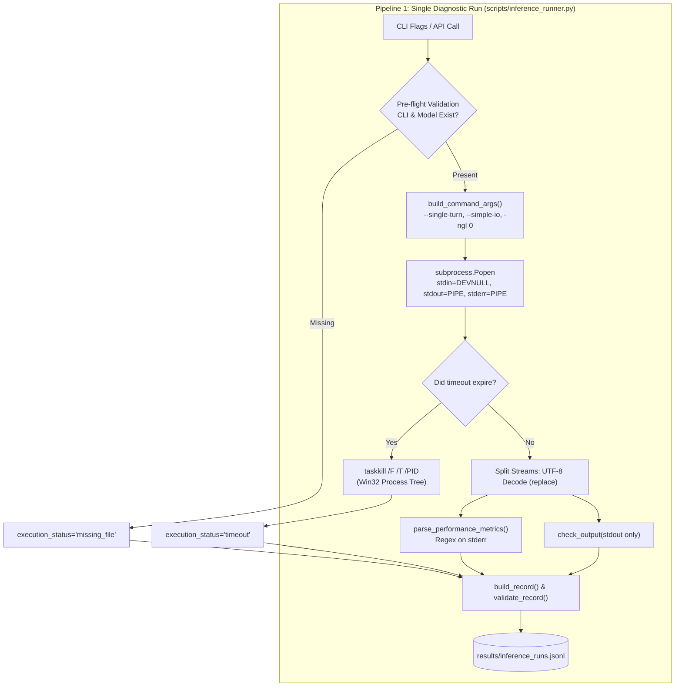
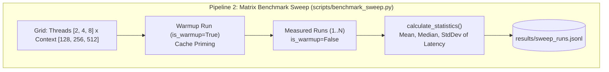
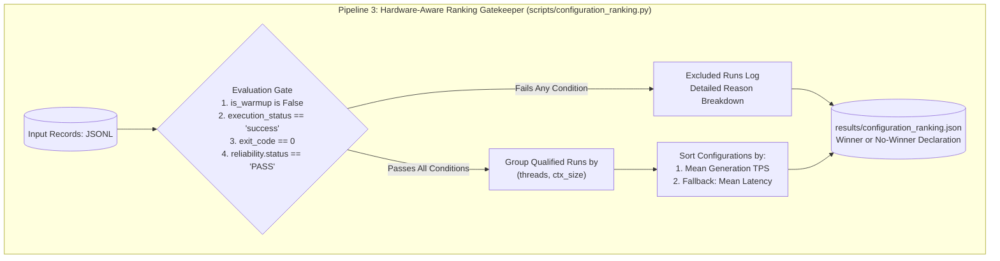

# BitNet Inference Lab: Deep-Dive System Architecture & Technical Specification

> **Audience:** Senior Systems, ML Infrastructure, and Performance Engineers  
> **Status:** Phase 1–7 Complete | Test Suite: 85/85 Passing | Schema: v1.1  
> **Repository:** `bitnet-inference-lab`

---

## 1. Executive Summary & Design Motivation

The **BitNet Hardware-Aware and Reliability-Aware Inference Lab** is an end-to-end benchmarking, evaluation, and diagnostic platform designed for Microsoft's **BitNet b1.58** ternary large language models executing on resource-constrained x86 CPU hardware (specifically Intel 13th Gen Core laptop architectures).

### The Critical Architectural Blind Spot in Standard Benchmarking
Standard LLM inference benchmarks monitor system metrics (tokens/second, prompt processing latency, memory usage) under the implicit assumption that if a process exits with return code `0`, the computation succeeded.

In experimental ultra-low-bit model architectures such as BitNet b1.58, this assumption fails catastrophically:
- Runtimes terminate with exit code `0` while emitting hundreds of question marks (`????`).
- Outputs degenerate into infinite loops (`Paris. Paris. Paris.`).
- Output buffers contain unescaped ANSI control codes, replacement characters (`\ufffd`), or NUL bytes (`\x00`).
- Models enter conversation loops waiting for `stdin`, causing unhandled subprocess timeouts.

### The Core Architectural Invariant
$$\text{Performance Validity} = (\text{Exit Code} == 0) \land (\text{Execution Status} == \text{"success"}) \land (\text{Reliability Status} == \text{"PASS"})$$

If an inference run fails the heuristic reliability gate, its throughput and latency metrics are **strictly disqualified from hardware ranking**. Speed without text validity is treated as a defect, not an optimization.

---

## 2. Complete Technology Stack & System Matrix

| Component | Technology | Specification / Role |
| :--- | :--- | :--- |
| **Primary Language** | Python 3.12 (compatible with $\ge 3.10$) | Strictly typed, zero external heavy dependencies for core execution. |
| **Testing Engine** | `pytest 9.1.1` | 85 automated unit and integration tests executing in $< 3.0\text{ s}$. |
| **Underlying C++ Engine** | `bitnet.cpp` (fork of `llama.cpp`) | Custom AVX2/AVX-512/AMX kernels compiled with Clang 22.1.3 on Windows. |
| **Target Architecture** | 13th Gen Intel Core i5-1334U | 10 Cores (2 Performance-cores, 8 Efficient-cores), 12 Threads, 15.7 GB RAM. |
| **Operating System** | Microsoft Windows 11 | Windows PowerShell execution with Win32 process tree management. |
| **Data Interchange** | JSON Lines (JSONL) & JSON | Versioned result schema (Schema v1.1) with append-only write guarantees. |
| **Process Control** | `subprocess` + `taskkill /F /T` | Non-blocking `DEVNULL` stdin, pipe-deadlock prevention, child tree kills. |
| **Math & Profiling** | `math`, `statistics`, `unicodedata`, `psutil` (optional) | Shannon entropy, moving-window $n$-grams, token density, RSS profiling. |

---

## 3. Repository Directory Topology

```
bitnet-inference-lab/
├── .gitignore                          # Strict exclusion of *.gguf, build artifacts, test runs
├── requirements.txt                    # Minimal environment manifest (pytest)
├── README.md                           # General introduction and reproduction instructions
├── docs/
│   ├── COLLABORATION_GUIDE.md          # Multi-engineer phase division & integration guide
│   ├── SYSTEM_ARCHITECTURE_AND_DEEP_DIVE.md # This deep-dive architectural document
│   ├── inference_blocker_notes.md      # Empirical Phase 1 CLI diagnosis & blocker logs
│   ├── project_background.md           # Research scope, hardware constraints, and goals
│   ├── reliability_rules.md            # Mathematical and heuristic rule specifications
│   ├── setup_guide.md                  # Step-by-step setup and command reproduction
│   └── PROJECT_STATUS.md               # Validation boundaries and unsupported claims
├── results/
│   ├── configuration_ranking.json      # Latest evaluated ranking summary (Schema v1.1)
│   ├── inference_runs.jsonl            # Append-only log of real and synthetic inference runs
│   ├── sample_record.jsonl             # Single verified Schema v1.1 reference record
│   ├── system_info.json                # Host hardware, CPU cache, and memory profile
│   ├── baseline_status.txt             # Historical record of initial I2_S failure
│   └── f32_experiment.txt              # Historical record of F32 incoherence failure
├── scripts/
│   ├── inference_runner.py             # Subprocess harness, stream isolation, timeout guard
│   ├── reliability_checker.py          # 15+ heuristic/entropy rules checking stdout text
│   ├── result_schema.py                # Schema v1.1 data builder and validator
│   ├── benchmark_sweep.py              # Matrix parameter sweep (threads x context)
│   ├── configuration_ranking.py        # Reliability gatekeeper & throughput ranking engine
│   ├── benchmark_report.py             # Legacy summary aggregator (v1.0 backward compatibility)
│   ├── demo_integration.py             # Synthetic multi-scenario runner for end-to-end validation
│   └── system_info.py                  # Host hardware, CPU topology, and memory profiler
└── tests/
    ├── fake_llama_cli.py               # 9-mode synthetic CLI stub for hermetic testing
    ├── test_inference_runner.py        # 15 tests: command builder, process kill, parsing, stubs
    ├── test_reliability_checker.py     # 37 tests: entropy, n-grams, loops, truncation, mojibake
    ├── test_result_schema.py           # 11 tests: schema v1.0/v1.1 validation, data source, roundtrips
    ├── test_configuration_ranking.py   # 10 tests: strict reliability gating, throughput sorting
    ├── test_benchmark_sweep.py         # 1 test: sweep matrix integration
    └── test_framework.py               # 11 tests: end-to-end legacy pipeline and selector tests
```

---

## 4. End-to-End Execution Pipelines & Data Flow

The architecture is partitioned into three distinct pipelines:







---

## 5. Algorithmic Deep Dive: The Reliability Gatekeeper

The reliability engine ([`scripts/reliability_checker.py`](file:///d:/bitnet/bitnet-inference-lab/scripts/reliability_checker.py)) enforces 15+ mathematical and heuristic rules on the generated text.

### 1. Information-Theoretic Density (Shannon Entropy)
To detect mode collapse where a model endlessly outputs single tokens, repetitive character runs, or degraded cyclic noise, the engine computes the empirical Shannon entropy in bits per character:

$$H(X) = -\sum_{i=1}^{V} P(c_i) \log_2 P(c_i)$$

Where $V$ is the set of unique non-whitespace characters in the text, and $P(c_i) = \frac{\text{count}(c_i)}{N}$.

```python
# scripts/reliability_checker.py
def compute_shannon_entropy(text: str) -> float:
    if not text:
        return 0.0
    length = len(text)
    counts = Counter(text)
    return round(-sum((c / length) * math.log2(c / length) for c in counts.values()), 4)
```

**Thresholds:**
- Length Guard: Computed only when non-space characters $\ge 50$ (avoids false-positive penalties on valid short answers like `"Paris."`).
- $H(X) < 2.0\text{ bits/char} \implies$ **`FAIL:low_entropy`**
- $2.0 \le H(X) < 2.8\text{ bits/char} \implies$ **`WARNING:low_entropy`**

### 2. Multi-Scale Word $N$-Gram Repetition Loops ($n \in [2..6]$)
The engine extracts rolling word tuples for sizes $n \in \{2, 3, 4, 5, 6\}$:
$$\text{Coverage}(n) = \frac{\text{max\_count} \times n}{\text{total\_words}}$$

**Thresholds:**
- Repeat Count $\ge 5$ AND Coverage $\ge 40\% \implies$ **`FAIL:repeated_{n}gram`**
- Repeat Count $\ge 3$ AND Coverage $\ge 25\% \implies$ **`WARNING:repeated_{n}gram`**

### 3. Trailing Tail-Loop Detector
Models frequently answer normally for the first 10 tokens and then lock into a repeating loop for the remainder of the context window.
- The engine isolates the trailing fraction:
  $$\text{tail\_words} = \text{max}(6, \lfloor \text{total\_words} \times 0.30 \rfloor)$$
- It slides a test cycle period $p \in [1, \lfloor \text{tail\_len} / 2 \rfloor]$ across the tail.
- If periodic identity $\frac{\sum [tail[i] == tail[i-p]]}{\text{tail\_len} - p} \ge 0.85$:
  - Cycles $\ge 4 \implies$ **`FAIL:tail_loop`**
  - Cycles $\ge 2 \implies$ **`WARNING:tail_loop`**

### 4. Question-Mark Degradation Filter
The characteristic symptom of severe generation failure observed in initial BitNet I2_S GGUF runs is an immediate stream of ASCII question marks.
- $q\_ratio = \frac{\text{count}('?')}{\text{non\_space\_chars}}$
- $q\_ratio == 1.0 \implies$ **`FAIL:only_question_marks`**
- $q\_ratio \ge 0.80 \implies$ **`FAIL:mostly_question_marks`**
- $0.30 \le q\_ratio < 0.80 \implies$ **`WARNING:many_question_marks`**

### 5. Byte-Level & Encoding Sanitization
- NUL Byte: `\x00` $\implies$ **`FAIL:nul_byte`** (indicates uninitialized C++ memory buffer leakage).
- UTF-8 Replacement Character: `\ufffd` $\ge 50\% \implies$ **`FAIL:replacement_chars`**; $\ge 10\% \implies$ **`WARNING:replacement_chars`**.
- ANSI Escape Sequences: Strips and detects raw terminal escape codes $\implies$ **`WARNING:ansi_escape`**.
- Mojibake: Detects double-encoded UTF-8 byte sequences $\implies$ **`WARNING:mojibake`**.

### 6. Context-Aware Token-Budget Truncation
If text ends mid-sentence without terminal punctuation (`.`, `!`, `?`, `"`, `')`):
- If requested tokens were specified and generated tokens reached $\ge 90\%$ of the budget:
  $$\text{generated\_tokens} \ge \lfloor \text{requested\_tokens} \times 0.90 \rfloor$$
  The condition is downgraded to an informational pass: **`INFO:token_cap_reached`**.
- Otherwise $\implies$ **`WARNING:truncated_output`**.

---

## 6. Subprocess Hardening & Win32 Process Tree Control

In [`scripts/inference_runner.py`](file:///d:/bitnet/bitnet-inference-lab/scripts/inference_runner.py), subprocess management was engineered to prevent common execution failures:

### The Interactive Input Hang Fix
`llama-cli` and `llama-completion` default to interactive mode when conversation flags are omitted. If the runtime awaits user input from console, standard Python `subprocess.Popen` deadlocks until timeout.
- **Remedy:** All calls explicitly pass:
  ```python
  stdin=subprocess.DEVNULL
  ```

### Windows Process Tree Termination
On Windows, executing `proc.kill()` on a `subprocess.Popen` instance terminates only the parent shell/wrapper process, leaving worker threads and child C++ processes running as CPU-consuming orphans.
- **Remedy:** On timeout or process kill:
  ```python
  if os.name == "nt":
      subprocess.run(
          ["taskkill", "/F", "/T", "/PID", str(proc.pid)],
          capture_output=True,
          check=False,
      )
  else:
      proc.kill()
  ```

### Non-Zero Exit Hex Decoding
Windows status codes are 32-bit unsigned integers often presented as negative signed integers (e.g., `-1073740791`).
- **Remedy:** The runner formats them in hex:
  $$-1073740791 \implies \texttt{0xC0000409 (STATUS\_STACK\_BUFFER\_OVERRUN)}$$
  $$-1073741819 \implies \texttt{0xC0000005 (STATUS\_ACCESS\_VIOLATION)}$$

---

## 7. Data Contract: Schema v1.1 Specification

Every run output written to [`results/inference_runs.jsonl`](file:///d:/bitnet/bitnet-inference-lab/results/inference_runs.jsonl) conforms to **Schema v1.1**, validated by [`scripts/result_schema.py`](file:///d:/bitnet/bitnet-inference-lab/scripts/result_schema.py).

```json
{
  "schema_version": "1.1",
  "run_id": "e75dfc19-fe0d-4a1e-acb8-570412f7d672",
  "timestamp_utc": "2026-11-14T12:00:00.000000+00:00",
  "data_source": "real",
  "config": {
    "cli": "C:\\path\\to\\llama-cli.exe",
    "model": "C:\\path\\to\\ggml-model-i2_s.gguf",
    "threads": 4,
    "ctx_size": 512,
    "prompt": "Explain what a 1-bit language model is in simple terms.",
    "requested_tokens": 16,
    "timeout_seconds": 30,
    "temp": 0.0,
    "seed": 42
  },
  "benchmark": {
    "is_warmup": false,
    "repeat_index": 1,
    "seed": 42,
    "temperature": 0.0,
    "config_id": "threads_4_ctx_512"
  },
  "execution_status": "success",
  "exit_code": 0,
  "error_message": null,
  "timing": {
    "total_seconds": 1.234
  },
  "performance": {
    "prompt_tps": 28.4,
    "gen_tps": 8.2,
    "peak_memory_mb": null
  },
  "output": {
    "stdout": "A 1-bit language model represents weights using ternary values.",
    "stderr": "[ Prompt: 28.4 t/s | Generation: 8.2 t/s ]\nllama_perf_context_print..."
  },
  "reliability": {
    "status": "PASS",
    "reasons": [],
    "codes": [],
    "metrics": {
      "char_count": 64,
      "non_space_chars": 53,
      "word_count": 10,
      "unique_word_ratio": 1.0,
      "qmark_ratio": 0.0,
      "replacement_char_ratio": 0.0,
      "alnum_ratio": 0.9811,
      "shannon_entropy": 4.1205,
      "unique_char_ratio": 0.3962,
      "non_printable_ratio": 0.0,
      "mojibake_count": 0,
      "top_ngram_repeats": {},
      "tail_loop_detected": false,
      "estimated_tokens": 12,
      "requested_tokens": 16
    },
    "rules_version": "1.1"
  }
}
```

### Invariants Enforced by `validate_record()`
1. `data_source` must be strictly `"real"` or `"synthetic"`.
2. `execution_status` must be one of `{"success", "timeout", "error", "missing_file"}`.
3. If `execution_status == "success"`, `exit_code` must be `0`.
4. `reliability.status` must be one of `{"PASS", "WARNING", "FAIL"}`.
5. `output.stdout` must contain generated text only; all diagnostic logs belong in `output.stderr`.

---

## 8. Automated Testing & Hermetic Emulation Framework

The test suite consists of **85 tests** that execute in $\approx 2.5\text{ seconds}$ without downloading external model files or compiling native C++ binaries.

```
============================= test session starts =============================
platform win32 -- Python 3.12.3, pytest-9.1.1, pluggy-1.6.0
collected 85 items

tests/test_benchmark_sweep.py .                                          [  1%]
tests/test_configuration_ranking.py ..........                           [ 12%]
tests/test_framework.py ...........                                      [ 25%]
tests/test_inference_runner.py ...............                           [ 43%]
tests/test_reliability_checker.py .....................................  [ 87%]
tests/test_result_schema.py ...........                                  [100%]

============================= 85 passed in 2.51s ==============================
```

### The 9-Mode Hermetic Test Stub: [`tests/fake_llama_cli.py`](file:///d:/bitnet/bitnet-inference-lab/tests/fake_llama_cli.py)
To test subprocess orchestration, pipe buffers, signal trapping, and reliability failures, the runner accepts an optional `command_prefix` seam:
```python
run_inference(..., command_prefix=[sys.executable, str(FAKE_CLI_PATH)])
```

The stub emulates 9 distinct operational scenarios via `--mode`:
1. `normal`: Outputs clean text and realistic `llama_perf_context_print` timing lines to `stderr`.
2. `question_marks`: Emits repeated `?` characters with exit code 0 to verify degenerate question-mark output gating.
3. `empty`: Emits nothing on stdout.
4. `garbled`: Emits `\ufffd` replacement characters and invalid byte sequences.
5. `hang`: Sleeps indefinitely to test timeout handling and process tree killing.
6. `nonzero_exit`: Exits with code `1` or Windows error codes to test error reporting.
7. `unsupported_arg`: Emits CLI syntax errors to stderr (`error: unknown argument`).
8. `non_ascii_bytes`: Writes raw multi-byte UTF-8 sequences to verify stream decoding.
9. `large_output`: Streams 256 KB of text to verify pipe buffers do not deadlock.

---

## 9. Important Code Snippets with Technical Commentary

### Snippet 1: Command Construction & Verified Non-Interactive Flags
```python
# scripts/inference_runner.py (lines 220-243)
def build_command_args(
    model: str | Path,
    threads: int = 4,
    ctx_size: int = 512,
    predict: int = 32,
    temp: float = 0.0,
    seed: int = 42,
    prompt: str = DEFAULT_PROMPT,
) -> list[str]:
    """Construct verified CLI argument list for single-turn non-interactive inference."""
    return [
        "--model", str(model),
        "--threads", str(threads),
        "--ctx-size", str(ctx_size),
        "--n-predict", str(predict),
        "--temp", str(temp),
        "--seed", str(seed),
        "--prompt", prompt,
        # Verified flags discovered in Phase 1 & 4:
        "--single-turn",           # Replaces unsupported --no-conversation
        "--simple-io",             # Suppresses readline and terminal formatting
        "--no-display-prompt",     # Prevents prompt echoing into stdout
        "--color", "off",          # Disables ANSI color sequences in output
        "--n-gpu-layers", "0",     # Forces CPU execution
    ]
```

### Snippet 2: Subprocess Execution with Deadlock Prevention
```python
# scripts/inference_runner.py (lines 310-345)
start_time = time.perf_counter()
try:
    proc = subprocess.Popen(
        cmd,
        stdin=subprocess.DEVNULL,       # Crucial: prevents hanging waiting for console input
        stdout=subprocess.PIPE,
        stderr=subprocess.PIPE,
    )
    # communicate() avoids pipe deadlocks by buffering streams concurrently
    stdout_raw, stderr_raw = proc.communicate(timeout=timeout)
    elapsed = time.perf_counter() - start_time
    exit_code = proc.returncode
    stdout = _to_str(stdout_raw)
    stderr = _to_str(stderr_raw)
except subprocess.TimeoutExpired:
    elapsed = time.perf_counter() - start_time
    _kill_process_tree(proc)           # Invokes taskkill /F /T on Windows
    # Recover any partial output buffered prior to the timeout
    partial_out = _to_str(getattr(proc, "stdout", None))
    partial_err = _to_str(getattr(proc, "stderr", None))
    return _finalize_record(
        execution_status="timeout",
        exit_code=None,
        stdout=partial_out,
        stderr=partial_err,
        elapsed=elapsed,
        ...
    )
```

### Snippet 3: Throughput Metric Extraction
```python
# scripts/inference_runner.py (lines 95-138)
def parse_performance_metrics(stdout: str, stderr: str) -> dict[str, float | None]:
    """Extract reported throughput without estimating or fabricating missing values."""
    combined = (stdout or "") + "\n" + (stderr or "")
    prompt_tps: float | None = None
    gen_tps: float | None = None

    # Pattern A: BitNet/llama-completion summary format
    m_prompt = re.search(r"Prompt:\s*([0-9]+(?:\.[0-9]+)?)\s*t/s", combined, re.IGNORECASE)
    if m_prompt:
        prompt_tps = float(m_prompt.group(1))

    m_gen = re.search(r"Generation:\s*([0-9]+(?:\.[0-9]+)?)\s*t/s", combined, re.IGNORECASE)
    if m_gen:
        gen_tps = float(m_gen.group(1))

    # Pattern B: llama.cpp standard timing lines
    if prompt_tps is None:
        m = re.search(r"prompt eval time\s*=.*?([0-9]+(?:\.[0-9]+)?)\s*tokens per second", combined)
        if m:
            prompt_tps = float(m.group(1))

    if gen_tps is None:
        m = re.search(r"(?<!prompt )eval time\s*=.*?([0-9]+(?:\.[0-9]+)?)\s*tokens per second", combined)
        if m:
            gen_tps = float(m.group(1))

    # Strict invariant: never estimate or fabricate missing metrics
    return {"prompt_tps": prompt_tps, "gen_tps": gen_tps, "peak_memory_mb": None}
```

### Snippet 4: The 4-Point Ranking Gatekeeper
```python
# scripts/configuration_ranking.py (lines 41-61)
for record in records:
    reasons = []
    
    # 1. Reject warmup runs
    if benchmark.get("is_warmup") is not False:
        reasons.append("Warmup or unspecified warmup status")

    # 2. Reject process crashes or hangs
    if record.get("execution_status") != "success":
        reasons.append("Execution was not successful")

    # 3. Reject non-zero exit codes
    if record.get("exit_code") != 0:
        reasons.append("Exit code was not zero")

    # 4. Reject runs failing reliability checks
    reliability = record.get("reliability")
    if not isinstance(reliability, dict) or reliability.get("status") != "PASS":
        reasons.append("Reliability status was not PASS")

    if reasons:
        excluded_runs.append({"threads": threads, "ctx": ctx_size, "reasons": reasons})
        continue

    # Only 100% reliable, successful runs reach sorting
    groups[(threads, ctx_size)].append(record)
```

---

## 10. Empirical Findings & Upstream Status

### Current Upstream Experimental Results
Real model executions conducted during Phase 1 ([`docs/inference_blocker_notes.md`](file:///d:/bitnet/bitnet-inference-lab/docs/inference_blocker_notes.md)) produced the following empirical records:

| Run | CLI / Executable | Model Format | Prompt Format | Observed Output | Reliability Result |
| :---: | :--- | :--- | :--- | :--- | :---: |
| 1 | `llama-cli.exe` | I2_S GGUF | Plain Prompt | `????????????????????` | **FAIL** (`only_question_marks`) |
| 2 | `llama-cli.exe` | I2_S GGUF | Plain Prompt | Hangs waiting for `stdin` input | **FAIL** (`timeout`) |
| 3 | `llama-completion.exe` | I2_S GGUF | `The capital of France is` | `...is a small city, and the capital of France...` | **FAIL** (Deterministic clause loop) |
| 4 | `llama-completion.exe` | I2_S GGUF | `Question: ... Answer:` | `"The capital of France is Paris. It is..."` | **FAIL** (Looping tail after 12 tokens) |
| 5 | `llama-cli.exe` | F32 GGUF | `The capital of France is` | `1. it. a the (` | **FAIL** (`repetitive_words`, low coherence) |

### The Upstream Pre-Tokenizer Warning
In all runs, `llama-completion` emitted the following stderr diagnostic:
```text
warning: missing pre-tokenizer type; fallback to 'default'
GENERATION QUALITY WILL BE DEGRADED
```
While this warning was observed directly in stderr during our runs, the causal explanation remains under investigation. Upstream issue [microsoft/BitNet#684](https://github.com/microsoft/BitNet/issues/684) reports that for the specific official BitNet-b1.58-2B-4T GGUF model discussed in that issue, the `tokenizer.ggml.pre` metadata key is missing from the GGUF header, causing the runtime to fall back to the default pre-tokenizer instead of the intended `llama-bpe` pre-tokenizer. Reports in that issue suggest this fallback leads to suboptimal token fragmentation, though this factor is investigated as part of our ablation rather than assumed as an established universal cause across all BitNet GGUF models.

### Hardware Ranking Status: Zero False Claims
Running [`scripts/configuration_ranking.py`](file:///d:/bitnet/bitnet-inference-lab/scripts/configuration_ranking.py) against the repository's real execution logs produces:
```json
{
  "report_type": "schema_v1.1_run_ranking",
  "total_runs": 2,
  "eligible_runs": 0,
  "excluded_runs": 2,
  "eligible_configurations": 0,
  "winner": null,
  "selection_note": "No eligible winner: no qualifying configuration has a measured throughput or elapsed-time value."
}
```
The lab honestly declares **no winning hardware configuration** because the underlying model output is not yet reliable.

---

## 11. Limitations, Invariants & Upstream Roadmap

### Invariants
1. **Never fabricate baselines:** We do not claim speed improvements on unverified or garbage output.
2. **Deterministic evaluation:** Temperature must be set to `0.0` and seed fixed to `42` during diagnostic comparisons.
3. **Stream hygiene:** Output evaluation must inspect `stdout` only. Stderr logs must never contaminate text heuristics.

### Limitations
- **Heuristic vs Semantic Correctness:** The reliability checker enforces syntax and statistical sanity (entropy, repetitions, byte encoding). It does not guarantee that the factual answer is correct (e.g., if the model coherently answers that Paris is the capital of Germany, the heuristics will pass).
- **Investigated Upstream Factors:** Output quality is being investigated through two reported upstream factors:
  1. FFN activation function mismatch in `bitnet.cpp` (reported in [microsoft/BitNet#588](https://github.com/microsoft/BitNet/issues/588) and [#602](https://github.com/microsoft/BitNet/issues/602)).
  2. Missing pre-tokenizer metadata (`tokenizer.ggml.pre`) in the GGUF header (reported in [microsoft/BitNet#684](https://github.com/microsoft/BitNet/issues/684)).
  Separately, model file integrity regarding the disputed claim of all-zero MLP weights ([microsoft/BitNet#608](https://github.com/microsoft/BitNet/issues/608)) continues to be investigated empirically.

### Next Steps for Engineers
1. **Upstream Monitoring & Ablation:**
   - Run the FFN activation ablation in bitnet.cpp, investigating the reported mismatch (tracking issues #588 and #602).
   - Test pre-tokenizer metadata override (`tokenizer.ggml.pre` = `llama-bpe`) for the BitNet b1.58 2B-4T model (tracking issue #684).
   - Continue empirical verification of model file tensor weights regarding the disputed claim in issue #608.
2. **Memory Utilization:** Activate the optional `psutil` sampling thread in `scripts/inference_runner.py` to record true Peak Resident Set Size (RSS) during prompt evaluation.
3. **Execution Sweep:** When clean model weights are available, run `python -m scripts.benchmark_sweep` across threads $t \in [1, 2, 4, 8, 12]$ and context sizes $c \in [128, 256, 512, 1024]$ to map the hardware Pareto efficiency frontier on Intel Core CPUs.
